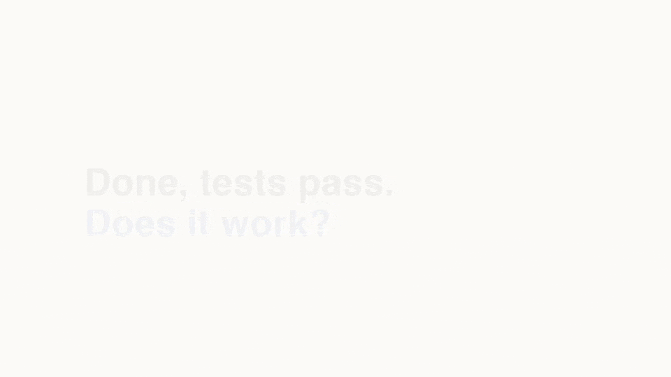

# Northwind Goods



An example app for the [verification framework](https://github.com/kennymatsudo/verification-framework): what a coding agent's "done" looks like when a verification harness sits behind it.

Two services, each with its own SQLite database: the shop (catalog, cart, checkout, orders) and a stand-in payment processor. A card ending in `0002` is always declined; any other number succeeds.

```sh
uv sync
scripts/dev.sh start      # shop on http://127.0.0.1:8800, payments on :8801
uv run pytest             # unit tests, which mock the repository and the payments client
scripts/dev.sh stop
```

What the shop must do is in [REQUIREMENTS.md](REQUIREMENTS.md). Nothing else is a source of expected behavior.

## What to look at

Everything below was produced by agent sessions run from this repo, with a person answering the agent's questions. The sessions are driven by `demo/session.py`; the storyboard is in [demo/storyboard.md](demo/storyboard.md) and the plan in [docs/plan.md](docs/plan.md).

- **A teammate's PR with green tests and a real bug: [#2 Add discount codes at checkout](https://github.com/kennymatsudo/verification-framework-storefront-example/pull/2).** The unit tests pass. The verification comment on the PR found that the card is charged the full price while the order is stored discounted, by reading the payments service's own ledger, and found a database migration gap no test covered. It carries a clip of the run and says which planned break each check was shown to fail on. The check and its run records are on branch `vf-verify-pr/2-checks`.
- **A PR the harness had nothing to add to: [#3 Show an estimated delivery date](https://github.com/kennymatsudo/verification-framework-storefront-example/pull/3).** The shop alone decides the date, so the comment says the unit tests are its home, reruns the existing checks to catch regressions, and raises a time-zone ambiguity in the requirement.
- **A feature built with proof: [#4 Add saved cards at checkout](https://github.com/kennymatsudo/verification-framework-storefront-example/pull/4).** One prompt, "build the Saved cards feature". The agent asked three questions the requirements left open, built the feature, built a recorded browser check for its four behaviors, showed each check failing on a planned break, verified on the running app, and opened the PR with the result and a clip.
- **The harness itself: [.agents/skills/verify-storefront](.agents/skills/verify-storefront).** [status.md](.agents/skills/verify-storefront/status.md) is each behavior's verdict, computed from the run records under `evidence/` by a script the agent can lower but not raise. [tools.md](.agents/skills/verify-storefront/tools.md) lists the probes and commands you can run by hand. [recordings.html](.agents/skills/verify-storefront/recordings.html) shows every recorded run.

The harness was built by the framework's own setup, not by hand. Claude Code reads skills from `.claude/skills`, so that folder is a symlink to `.agents/skills`.

## Grading the checks

After the agent built the cart and checkout checks, they were run against ten deliberate bugs the agent never saw, kept in a separate repo. Nine were caught; the tenth was in a feature outside the agreed scope. The breaks and the grader are published alongside this repo once the demo is complete.
